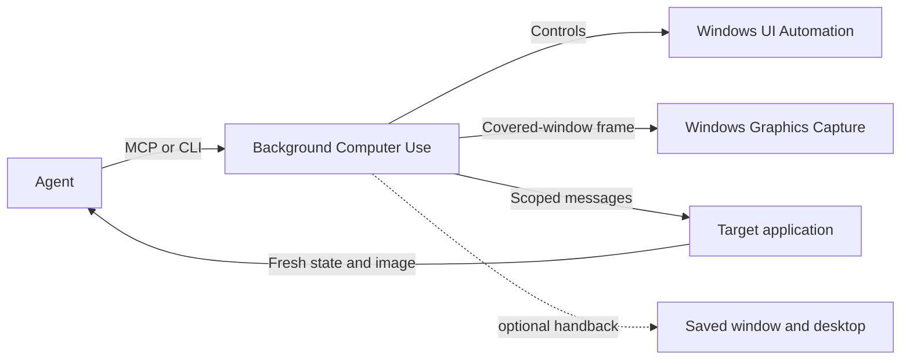

# Background Computer Use

**Inspect and operate covered Windows applications without taking over the user's mouse.** Background Computer Use is a local Codex plugin marketplace for background window capture, accessibility-based controls, verified window-message clicks, and an explicit handoff to foreground mouse control when an app requires it.

It helps an agent work with an editor, file manager, game launcher, or other desktop app while the user keeps another window in front. Each action is bound to the observed window and process, and returns fresh state for verification.

## What it does

- Captures covered windows through Windows Graphics Capture without activating or restoring the target.
- Reads supported UI Automation controls and performs scoped control actions.
- Clicks verified pixels inside a captured window without moving the physical pointer.
- Inspects verified child-process surfaces, including embedded WebView content.
- Offers optional, guarded return to the saved foreground window and virtual desktop after an app-triggered focus change.
- Hands off to foreground mouse control when an app requires ordinary physical input.

The plugin does not silently inject global mouse or keyboard input. Some apps ignore background messages or require raw/foreground input, and minimized, protected, secure-desktop, or non-rendering windows may not be available. A successful message delivery is not proof that the application accepted the action.

## 0.1.9 — faster, typing-tolerant handback

An app can activate itself while an agent works in the background. With `restore_foreground` explicitly enabled, the plugin now makes an immediate foreground-only retry before taking its fresh screenshot if Windows has restored the desktop but has not yet published the saved foreground window.

Keyboard activity alone no longer cancels that opted-in handback while the cursor remains still and the exact action-activated window is still foreground. The result reports `user_input_since_observation`. Pointer movement or a different foreground window still stops restoration. A separate `minimize_activating_window` option is available when it is acceptable to minimize the app window that surfaced.

In the live VirtualBox Manager Home-view check, the first native call restored the desktop in 61 ms and the immediate foreground-only retry verified the exact saved ChatGPT window in 58 ms. The returned result confirmed the foreground HWND. The typing-tolerance path is covered by a regression test; concurrent typing did not occur during that particular live run.

## How the request flows



## Install from this marketplace

This public repository is configured as the **Background Computer Use** plugin marketplace:

```powershell
codex plugin marketplace add gcottom/codex-background-computer-use
codex plugin add background-computer-use@background-computer-use-marketplace
```

Codex must be installed locally and the plugin's native helper must be built and configured separately. See the plugin setup guide for Windows and Python requirements, helper build steps, and verification.

The local Windows host also needs a trusted, self-contained native helper. See the [plugin setup guide](plugins/background-computer-use/README.md) for requirements, build and configuration steps. The helper is not downloaded or executed automatically by the marketplace.

## Release evidence

- Plugin version **0.1.9**, native helper **1.7.0**.
- **39** Python/core/server tests pass.
- The native helper builds with locked NuGet dependencies using .NET SDK 10.0.403.
- The live VirtualBox check verified return to the exact saved ChatGPT window after a virtual-desktop switch.

Full build hashes, test receipts, historical behavior, and limitations are documented in [VALIDATION.md](plugins/background-computer-use/VALIDATION.md). See [CHANGELOG.md](plugins/background-computer-use/CHANGELOG.md) for the release history and [THIRD_PARTY.md](plugins/background-computer-use/THIRD_PARTY.md) for dependency notices.
