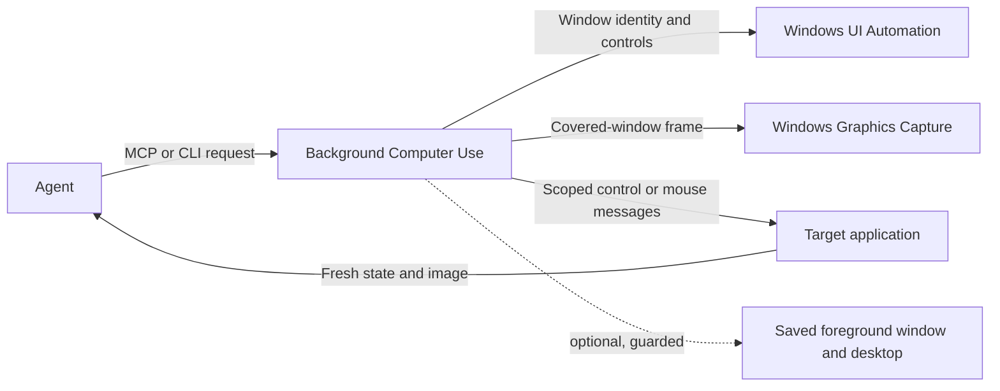

# Background Computer Use

**Inspect and operate covered Windows applications without taking over the user's mouse.** Background Computer Use combines Windows Graphics Capture, UI Automation, and window-scoped messages in a local Codex plugin. It keeps the target window behind other apps when the application supports background interaction, then returns a fresh observation so an agent can verify the result.

It is useful when an agent needs to check or change a supported control in an editor, file manager, game launcher, or other desktop app while the user keeps working in another window. When an app requires ordinary mouse input, the plugin offers an explicit handoff to the existing foreground Computer Use workflow.

## How it works



The agent binds each observation to a specific window and process. Actions use fresh, single-use observations; a changed window, control, process, or geometry must be inspected again. Captures come from the selected window rather than a desktop screenshot, so another window can cover the target without hiding its captured pixels.

## Capabilities

- Capture visible or covered windows through Windows Graphics Capture (WGC), without activating or restoring the target.
- Inspect current accessibility controls and supported UI Automation patterns.
- Set supported values and invoke, toggle, select, expand, collapse, or scroll controls.
- Click verified pixels inside the captured window using window-scoped messages, without moving the physical pointer.
- Capture and interact with verified child surfaces, including embedded WebView content.
- Optionally restore the saved foreground window and virtual desktop after an application action changes focus.
- Hand off to foreground mouse control when background messages are unsuitable.

### Focus handback

Set `restore_foreground: true` on an action when the user wants the previously active app and desktop returned afterward. The native helper first attempts handback during the action. If Windows has switched desktops but has not yet published the exact foreground window, the plugin makes a foreground-only retry before taking its fresh verification screenshot.

With this explicit option enabled, keyboard activity alone does not cancel handback while the pointer remains still and the exact action-activated window is still foreground. The result reports `user_input_since_observation`. Pointer movement or a different foreground window cancels handback. This lets typing continue toward the saved app after an app-triggered focus change without overriding a subsequent pointer move or app switch.

If the app still holds focus, a separate `minimize_activating_window: true` option can minimize the current foreground window after verifying it belongs to the action app family. The app stays running. The result reports whether Windows actually minimized the window and whether the saved foreground window became active. Use this only when minimizing that activated app window is acceptable.

## Limitations

Background automation is not universal remote control. Apps may ignore window messages, activate themselves in response to UI Automation, or require raw/foreground input. Minimized, protected, secure-desktop, or non-rendering windows may not be capturable. A successful message means Windows delivered the request; it does not prove the application accepted it. Always inspect the returned control state or image.

The desktop restoration interface is an internal, Windows-version-sensitive Shell service. Virtual-desktop handback requires a supported Windows 11 build (22H2 or later). Unsupported or denied calls are reported; the plugin does not silently inject global keyboard or mouse input.

## Requirements

- Windows x64. WGC requires Windows 10 build 19041 or later.
- Python 3.10 or later for the MCP server and CLI.
- A published, self-contained native helper. Building it requires the pinned .NET SDK 10.0.403 and network access to restore locked NuGet dependencies.
- Codex with local plugin support to install it from the marketplace.

The bundled MCP server starts with the `py -3` Windows launcher. If your Python installation uses a different launcher, update the MCP command to match your environment.

## Install from the marketplace

This public repository is configured as the **Background Computer Use** plugin marketplace:

```powershell
codex plugin marketplace add gcottom/codex-background-computer-use
codex plugin add background-computer-use@background-computer-use-marketplace
```

Codex must be installed locally. Build and configure the native helper separately after installing the plugin; the marketplace does not automatically download or run native executables.

## Build and configure the native helper

Install .NET SDK 10.0.403, then build from the plugin directory. The script uses `dotnet` from `PATH` by default, accepts an explicit `-DotnetPath`, and writes output outside the source tree under `%LOCALAPPDATA%\BackgroundComputerUse` by default.

```powershell
Set-Location .\plugins\background-computer-use
.\native\Build.ps1
```

If you have the pinned SDK at a custom location, pass it explicitly:

```powershell
.\native\Build.ps1 `
  -DotnetPath 'C:\Path\To\dotnet.exe' `
  -OutputPath "$env:LOCALAPPDATA\BackgroundComputerUse\native" `
  -BuildRoot "$env:LOCALAPPDATA\BackgroundComputerUse\build"
```

Configure the helper produced by the build with the plugin's `configure_backend` tool. This records its SHA-256 so a replaced executable is rejected until reviewed and reconfigured. Then call `background_status` and `list_background_windows` to confirm readiness.

For example, a CLI configure request can be saved as JSON and passed with `--args-file`:

```json
{"helper_path":"C:\\Users\\<user>\\AppData\\Local\\BackgroundComputerUse\\native\\BackgroundComputerUse.Native.exe"}
```

```powershell
py -3 server.py --call configure_backend --args-file .\configure-backend.json
py -3 server.py --call background_status
py -3 server.py --list-tools
```

The configured executable is local to the host. The marketplace does not download or execute a native helper automatically.

## Use the CLI

The MCP server can also be run directly for inspection or scripted use:

```powershell
py -3 server.py --list-tools
py -3 server.py --call list_background_windows
py -3 server.py --call observe_background_window --args-file .\observe-request.json
```

Use the tool schemas returned by `--list-tools` for request fields. After each action, inspect the returned fresh state before taking another action. See the bundled [agent workflow](skills/background-computer-use/SKILL.md) for the complete operating loop.

## Validation and release notes

The 0.1.9 release passes 39 Python/core/server tests and a locked native-helper build. A live VirtualBox Manager Home-view test switched desktops and verified return to the exact saved ChatGPT foreground window. Native handback work measured about 119 ms across the initial desktop restoration and the immediate foreground-only retry. That live run had no concurrent keyboard input; the typing-tolerance behavior is covered by regression tests.

See [VALIDATION.md](VALIDATION.md) for current release evidence and limits, [VALIDATION_HISTORY.md](VALIDATION_HISTORY.md) for previous release receipts, [CHANGELOG.md](CHANGELOG.md) for version history, and [THIRD_PARTY.md](THIRD_PARTY.md) for native dependency notices.
